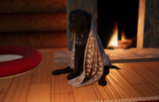
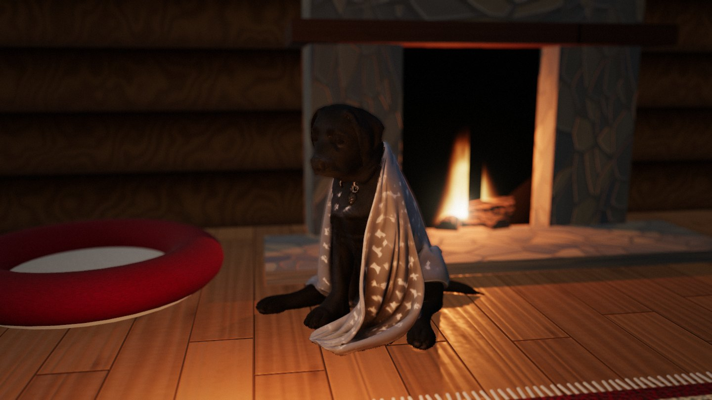
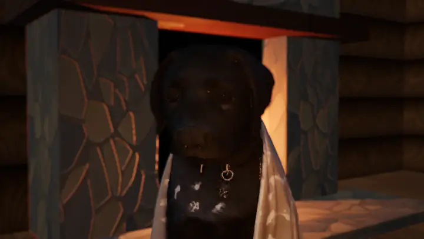
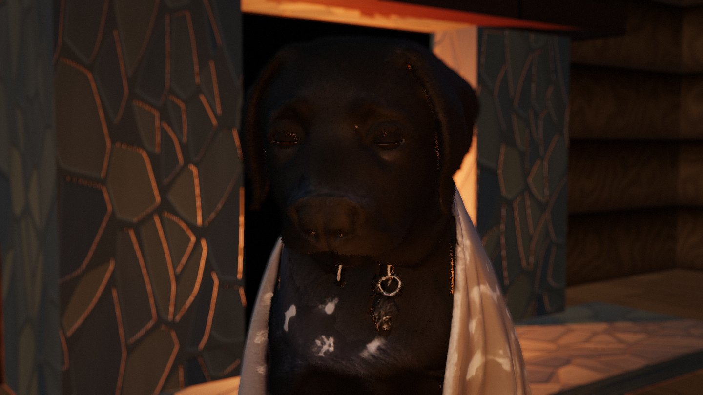
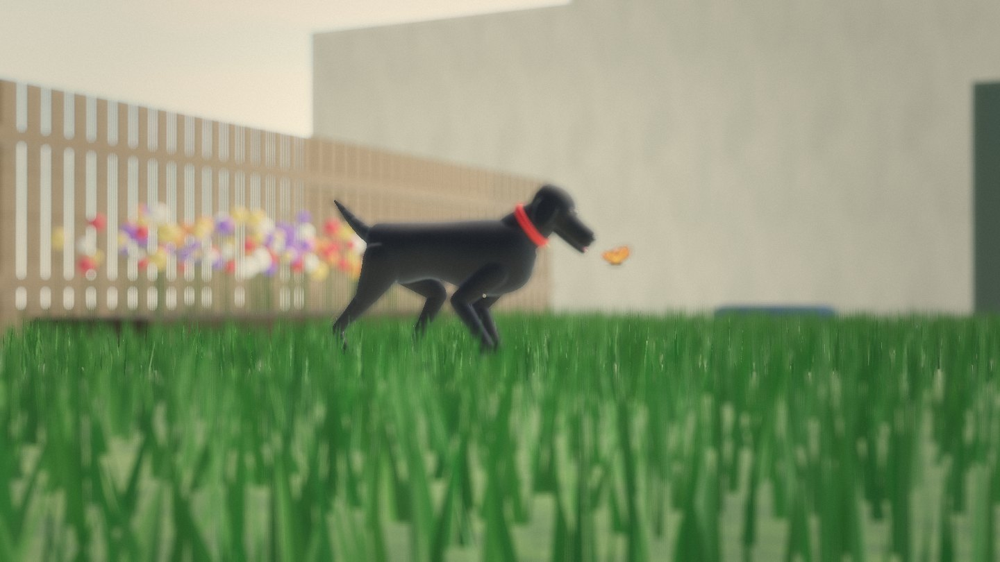
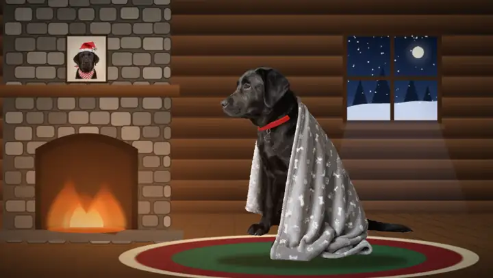
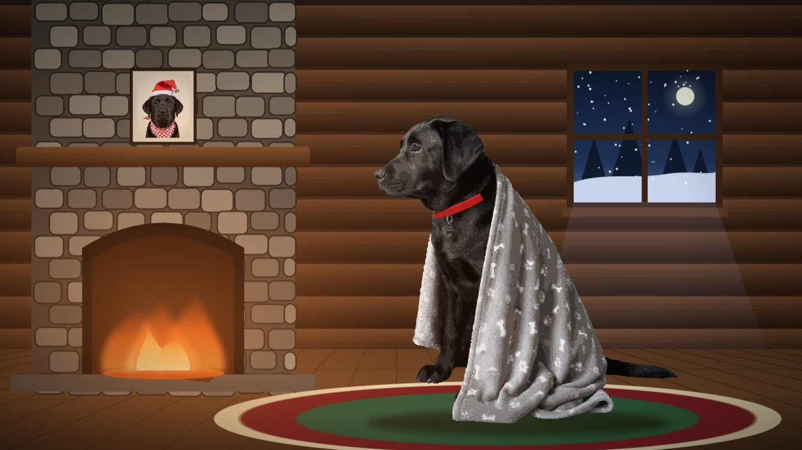
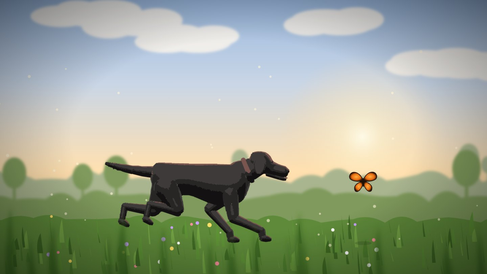

<div align="center">



# Spot Screensaver

**Spot naps by the fire, dreams, and chases butterflies in his dream. A macOS screen saver and a browser screensaver, in 3D and in vector.**

[Install on a Mac](#install-the-macos-screen-saver) · [Watch in a browser](#watch-it-in-a-browser) · [The loop](#the-loop) · [Run it locally](#run-it-locally-step-by-step) · [How it works](#how-it-works) · [Limits](#limits) · [Contributing](#contributing)


[](https://github.com/Gitguy268/spot-screensaver/actions/workflows/test.yml)



</div>

Spot is a two-year-old black lab with a red collar. In this screensaver he sits wrapped in his blanket by the fire and slowly dozes off. His head nods, his paws start to twitch, his lips puff a muffled woof, and the picture dissolves into his dream: a golden garden where he gallops after a butterfly, a tennis ball or a red laser dot. Then he wakes, looks around, thumps his tail and nods off again.

There are two looks. The **3D** version is a three.js scene with a 3D model of Spot. The **vector** version is an SVG illustration traced from his portrait. **Both** takes turns, one loop each. Everything is one self-contained `index.html`, which the macOS screen saver bundle carries inside it.

<!-- live-links -->
**Live:** [gitguy268.github.io/spot-screensaver](https://gitguy268.github.io/spot-screensaver/) · [gitguy268-spot-screensaver.vercel.app](https://gitguy268-spot-screensaver.vercel.app)
<!-- /live-links -->

## Install the macOS screen saver

1. Download **`SpotScreensaver.saver.zip`** from the [latest release](https://github.com/Gitguy268/spot-screensaver/releases/latest) and unzip it.
2. Double-click **`SpotScreensaver.saver`**. macOS asks whether to install it for you or for all users.
3. The bundle is signed ad hoc but not notarized (that needs a paid Apple developer account), so macOS may say it can't check it for malicious software. Then open **System Settings → Privacy & Security**, scroll down and click **Open Anyway**, or run this once in Terminal:

   ```sh
   xattr -dr com.apple.quarantine ~/Downloads/SpotScreensaver.saver
   ```

4. In **System Settings → Screen Saver**, pick **Spot**. **Options…** sets the style (3D, Vector or both taking turns), the quality, and the sound (fire crackle and snoring, off by default).

It runs on macOS 12 or newer, on Apple silicon and Intel Macs. To remove it, right-click Spot in the Screen Saver settings and choose **Delete "Spot"**, or delete it from `~/Library/Screen Savers`.

## Watch it in a browser

Open the [live page](https://gitguy268.github.io/spot-screensaver/), press **Full screen** and leave it. Move the mouse to show the controls:

| Key or control | What it does |
|---|---|
| **3D / Vector / Both** | switch the style (Both takes turns every loop) |
| **Nap / Dream / Chase / Wake**, `1`–`4` | jump to a part of the loop |
| `V` | toggle 3D and vector |
| `F` | full screen |
| `M` | sound on or off |
| **Quality** | Low, Medium, High (the page reloads) |

<details>
<summary><b>URL options</b></summary>

The same options the macOS bundle uses, for kiosks and second screens:

| Option | Values |
|---|---|
| `style` | `3d`, `vector`, `alternate` |
| `quality` | `low`, `medium`, `high` |
| `scene` and `at` | start at `nap`, `dream`, `chase` or `wake`, `at` seconds in |
| `speed` | time multiplier, for example `4` |
| `seed` | a number: the same seed plays the same loop |
| `fps` | frame-rate cap (60 in a browser, 30 in the screen saver) |
| `saver=1` | no controls, no captions, no cursor |
| `sound=1`, `caption=0` | sound on at start, captions off |

Example: `index.html?style=vector&saver=1&speed=2`

</details>

## The loop

<p align="center"></p>

| Part | Length | What happens |
|---|---|---|
| **Nap** | 45–75 s | He dozes in his blanket. His head sinks slowly and catches back up, he breathes slowly, an ear flicks. The camera cuts between three slow shots. |
| **Dream** | 18–28 s | The camera drifts in to his face. His front paws paddle in bursts, his lips puff, his eyes move under the lids, and the picture dissolves into light. |
| **Chase** | 36–54 s | In his dream: a golden garden and a gallop after a butterfly, a ball or a red laser dot, a different one each time. Soft focus, warm haze, pollen in the air. |
| **Wake** | 14–20 s | The dream dissolves back. He opens his eyes, looks around, thumps his tail, and slowly dozes off again. |

Lengths, prey and camera moves are random, so the loop doesn't repeat exactly.

<p align="center">
  
  
</p>

### The vector version

<p align="center"></p>

<p align="center">
  
  
</p>

<!-- run-steps:start -->
## Run it locally, step by step

1. **Get the code:**

   ```sh
   git clone https://github.com/Gitguy268/spot-screensaver.git
   cd spot-screensaver
   ```

2. **Open `index.html`** by double-clicking it. There is nothing to install or build. (If your browser blocks pages opened from disk, double-click `start.command` instead; it serves the folder on <http://localhost:5212/> with Python. Press `Ctrl+C` in the terminal to stop.)

**To change the code** you need [Node.js](https://nodejs.org) 22 or newer:

```sh
npm ci
npm run dev       # live-reloading dev server on http://localhost:5210/
npm run build     # rebuilds ./index.html from src/
npm run saver     # builds dist/SpotScreensaver.saver.zip (macOS, needs the Xcode Command Line Tools)
bash macos/build.sh --install   # …and copies it to ~/Library/Screen Savers
```
<!-- run-steps:end -->

## How it works

<details>
<summary><b>The director</b></summary>

`src/director.js` is plain JavaScript with unit tests. It runs the loop (nap, dream, chase, wake), picks the lengths and the prey from a seeded random generator, and hands both styles the same frame on every tick: the phase and time, how asleep Spot is, how hard he is dreaming, and the "veil" that dissolves the room into the dream and back.

</details>

<details>
<summary><b>3D: bringing a 3D model to life without a skeleton</b></summary>

Spot here is an AI-generated 3D model of him sitting in his blanket, with its textures resized for the web (`blender/prepare_scan.py`). It has no skeleton, so `src/three/napper.js` gives every vertex soft weights at load time:

- **Where it is:** neck, head, chest, front paws, tail, ears, cheeks.
- **What colour the texture is there:** black fur or the light blanket, so the blanket bunched behind his head barely moves with it.

The weights are smoothed over the mesh so nothing tears. Each frame the CPU moves the 30,000 vertices with that blend: a two-joint head nod, breathing, paws paddling, lips puffing, ears flicking and a tail sweep.

The eyelids are small domes found by casting a ray at each eye. A crease line shows when they are shut. On Medium and High, a shell-fur coat grows on the black fur only, and its hairs are placed by 3D noise on the rest pose, so they don't swim as he moves.

The cabin, the fire, the garden and the dream dog come from [Spot-light HD](https://github.com/Gitguy268/spot-light-hd). The dream dog is built from tubes, with IK legs and shell fur. The fire is a noise shader on crossed planes. The post-processing chain is depth of field, bloom (in the dream only while the veil is up, because the sky is very bright), and a pass that grades the dream, adds grain and a vignette, and draws the veil.

</details>

<details>
<summary><b>Vector: tracing Spot</b></summary>

`scripts/trace.mjs` cuts the white background away from his side portrait with ImageMagick and traces it with [imagetracerjs](https://github.com/jankovicsandras/imagetracerjs) into 24 colour layers. That gives about 1,600 shapes, which are committed as `src/vector/traced/spot-blanket.js`.

`src/vector/napper.js` cuts those shapes into regions that move on their own: the head, an ear, a front paw and the tail. Each region draws the shapes it overlaps, clipped to its outline. The body beneath keeps a hole the size of the part, and the part is drawn slightly larger, so no gap opens when it moves. On top of that: a red collar (his real one), an eyelid that slides shut, and a lash line.

The dream gallop is a flipbook. `scripts/gallop-frames.mjs` renders one stride of the 3D dog side-on into 12 frames and traces each one. The cabin, the fire, the snowy window and the parallax meadow are drawn in code, with SVG gradients and blur filters.

</details>

<details>
<summary><b>The macOS bundle</b></summary>

`macos/SpotSaverView.m` is a `ScreenSaverView` in Objective-C, so no Swift runtime is loaded into `legacyScreenSaver`. It hosts a `WKWebView` that loads the bundled `index.html` with `?saver=1` and the options from its Options sheet, saved in `ScreenSaverDefaults`.

- The preview thumbnail in System Settings runs at Low quality and 15 fps; the real screen saver is capped at 30 fps.
- macOS keeps screen saver processes alive after they stop, so on `com.apple.screensaver.willstop` the view unloads the page and the host quits.
- `macos/build.sh` compiles arm64 and x86_64 with clang, joins them with `lipo`, signs the bundle ad hoc and zips it. It builds in a temporary folder, because `codesign` rejects the `._` files that macOS writes on exFAT drives.

</details>

<details>
<summary><b>Tests</b></summary>

```sh
npm run test:unit                       # the director (node:test)
npx playwright install chromium webkit
npm run smoke                           # both styles x every scene, Chromium and WebKit, from file://
GPU=1 npm run smoke                     # the same on the real GPU, with frame rates
MINUTES=10 node tests/soak.mjs          # 3D at 2560x1440 High: memory and GPU objects must stay flat
npm run capture                         # regenerates the pictures in docs/
```

CI runs the build check, the unit tests and the smoke test on every push, and builds and checks the `.saver` on a macOS runner.

Last local run, on a MacBook with an M4:
- Chromium at Medium: 55–60 fps for both styles. WebKit: 38–59 fps, depending on what else the Mac is doing.
- 30 fps inside the screen saver bundle.
- A 10-minute soak at 2560×1440 High held 30 fps, with the JS heap flat at about 35 MB.

</details>

## Limits

- The macOS bundle is not notarized, so the first launch needs the steps above.
- **3D dream chase:** the galloping dog is the procedural one from Spot-light HD, not the 3D model of Spot. The model is a single piece with the blanket fused on, so it can only doze sitting up. That's why the chase happens in a dream, softened by focus and haze.
- **Vector version:** it is a traced illustration. The moving parts are small rotations of cut-out regions, not a full skeleton.
- **Multiple displays:** each display runs its own copy. Several 5K displays at High quality will make a laptop warm, so use Medium or Low there.
- **Testing:** this was tested on one Apple-silicon Mac (both styles, in a test host and in the browser), in Chromium and WebKit. Not tested: Intel Macs, Firefox, phones, and long runs with several screens.

## Contributing

Issues and pull requests are welcome, see [CONTRIBUTING.md](CONTRIBUTING.md). Change the files in `src/`, run `npm run build`, and commit the new `index.html` with your change. Run the tests first.

## Licence

MIT, see [LICENSE](LICENSE). three.js keeps its own licence. The pictures of Spot are not covered by the MIT licence: the 3D model, the portrait and the traced vector Spot. See [NOTICE](NOTICE).
